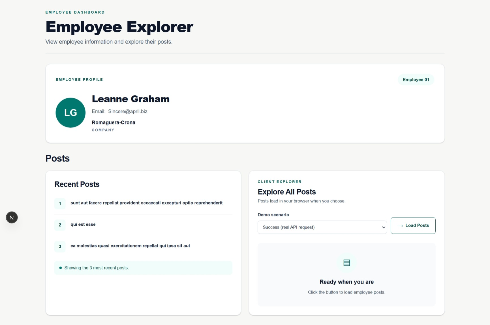
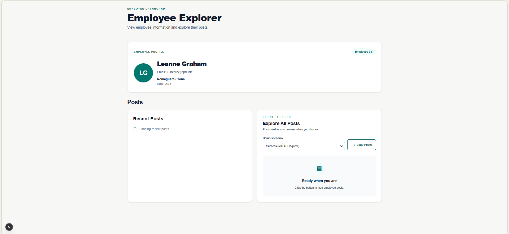
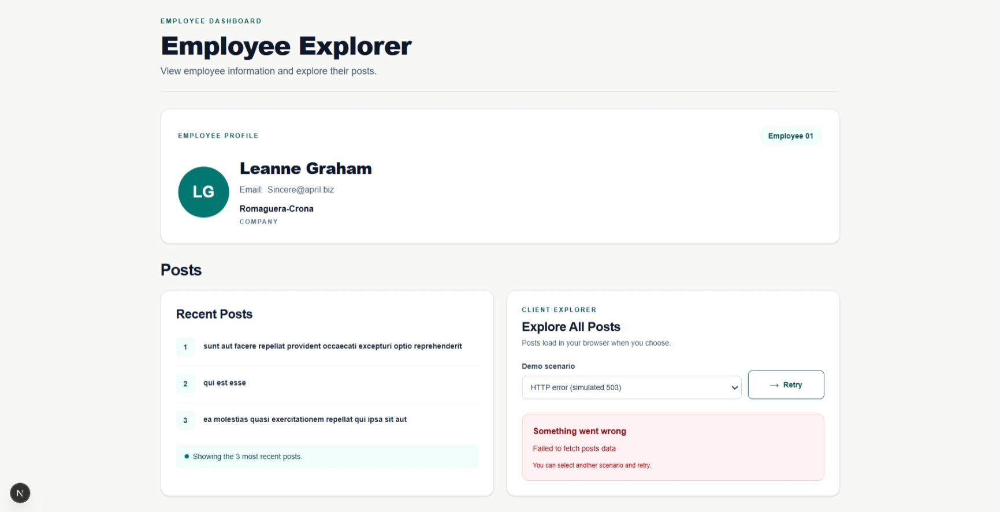
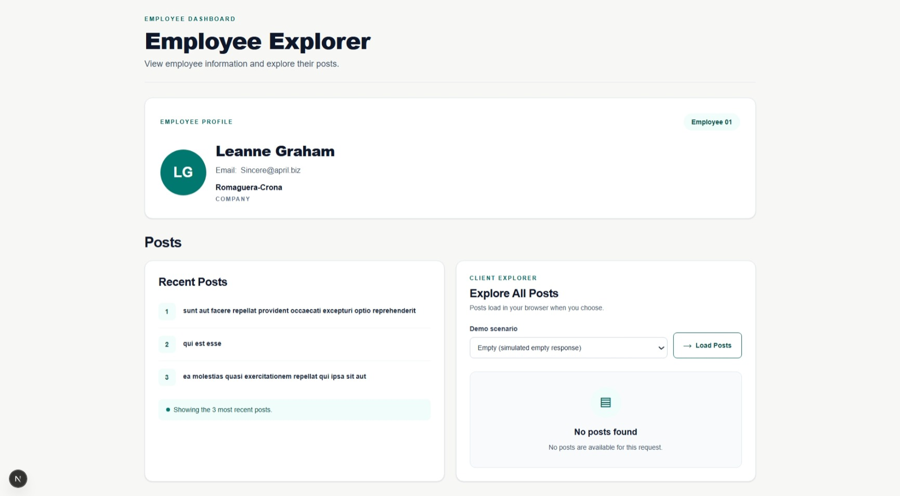

# Testing Documentation

## Overview
This document describes the testing process for the Employee Explorer application.

| # | Test Scenario | Expected Result | Actual Result | Status |
|---|---|---|---|---|
| 1 | Employee profile | Employee name, email, and company name are displayed. | A loading message appeared first, followed by the employee's name, email, and company name. | PASS |
| 2 | Recent posts preview | A maximum of three post titles are displayed. | Three post titles appeared after loading, followed by the message "Showing the 3 most recent posts." | PASS |
| 3 | Suspense fallback | A loading message appears while the recent posts preview is loading. | "Loading recent posts..." appeared before the three titles. The page title and other sections remained visible. | PASS |
| 4 | Initial client state | Posts are not fetched before clicking Load Posts. | The Network tab showed 0 requests before clicking Load Posts. | PASS |
| 5 | Slow scenario | Loading feedback appears during the intentional delay, then posts are displayed. | Loading feedback appeared during the delay. All 10 posts appeared afterward. | PASS |
| 6 | Duplicate click prevention | The user cannot trigger multiple requests while loading. | The Load Posts button was disabled while the request was loading. | PASS |
| 7 | Success scenario | Posts are fetched and their titles and bodies are displayed. | After clicking Load Posts, a request appeared in the Network tab and the posts loaded successfully. | PASS |
| 8 | HTTP error scenario | A simulated HTTP 503 error is handled and an appropriate message is displayed. | The application displayed "Something went wrong" and "Failed to fetch posts data". The Retry button was available. | PASS |
| 9 | Empty scenario | A successful empty response displays a "No posts found" message. | The simulated successful response returned an empty array. "No posts found" appeared without an error message. | PASS |
| 10 | Error recovery | After an HTTP error, switching to Success and retrying loads posts successfully. | The first retry displayed a connection error, and the Network tab showed a failed request. The second retry succeeded and displayed the posts. | PASS WITH NOTE |
| 11 | Section independence | A problem loading one section does not prevent the other sections from remaining visible. | The Employee Profile and Recent Posts preview remained visible while the Client Post Explorer displayed an error. | PASS |
| 12 | Responsive layout | The dashboard remains usable at approximately 360px screen width. | At 360px, the sections fitted the screen, the selector and button were arranged vertically, and vertical scrolling worked without visible horizontal overflow. | PASS |
| 13 | ESLint | The project passes linting without errors. | `npm run lint` completed successfully with no lint errors. | PASS |
| 14 | Production build | The project builds successfully for production. | `npm run build` completed successfully. Compilation, TypeScript checks, and page generation finished without errors or hanging-promise rejections. | PASS |

## Screenshots

### 1.Dashboard

### 2. Server Preview Loading

### 3. Client HTTP Error

### 4. Client Empty State

## Questions:
1.Where does each request execute, and what evidence helped you verify that?

- The Employee Profile and Recent posts Preview requests executes on the server because it is fetched inside an async Server Component.
- The Client Post Explorer request executes in the browser because it is triggered by a button click inside a Client Component using 'use client'.
Evidence: I checked the component structure in Next.js and used the browser's Network tab. Before clicking Load Posts, there were no client-side posts requests. After clicking the button, the posts request appeared in the browser's Network tab.

2.Why did you choose server fetching for the profile and client fetching for the button?

- Employee Profile and Recent Posts Preview don't require user interaction before loading, so I chose server-side fetching using a Server Component.
- Client Post Explorer: It requires an interaction therefore I used a Client Component and triggered the fetch through a button click.

3.What activates the preview’s Suspense fallback? Why doesn’t the click-handler request activate it automatically?

- Recent Posts Preview: The component has a two-second delay in its asynchronous server-side work. While that component is waiting, its Suspense boundary displays the fallback, such as "Loading recent posts...".
- Client Post Explorer: Its fetch is started separately inside the button's click handler. Suspense does not automatically detect this so we use a loading state to display loading feedback.

4.What would change if you moved the preview’s boundary around the whole dashboard?

 The Employee Profile and Client post Explorer would disappear temporarily.while
 Recent Posts Preview would show the loading fallback and Once the suspended work finishes, the dashboard content would appear.

5.How does your custom error class help, and what does super(message) do?

- ApiError: Defines a custom error type that our application can create when an HTTP request fails. It also stores the HTTP status code, so we can identify the specific HTTP failure.
- super(message): Calls the constructor of the parent Error class and passes the error message to it. 

6.What is the difference between an HTTP failure, a network failure, and an empty result?
- HTTP failure: It happens when the browser successfully communicates with the server, but the server responds with an unsuccessful HTTP status such as 503.

- Network failure: It happens when the browser cannot connect to the server, for example, because of an internet connection problem or because the API server cannot be reached.

- Empty result: It happens when the API responds successfully, but returns empty data, such as an empty array [].

7.What happens if employee ID 1 is changed to 2 in all three sections?
Because the employee ID is included in the API URL so all three sections display data for employee 2 instead.

